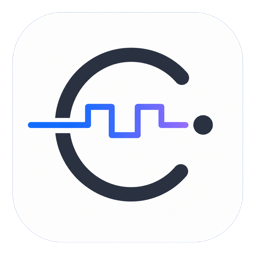

<p align="center">
  
</p>

<h1 align="center">Chrona</h1>

<p align="center">绘制数字时序图，观察延迟如何改变信号边沿。</p>

<p align="center">
  <a href="docs/quickstart-timing-diagram.md">快速入门</a> ·
  <a href="https://github.com/CanvasQAQ/Chrona/releases">下载桌面版</a> ·
  <a href="CHANGELOG.md">版本记录</a>
</p>

<p align="center">
  <a href="https://github.com/CanvasQAQ/Chrona/actions/workflows/build-desktop.yml"></a>
</p>

Chrona 是面向硬件设计、验证和系统工程师的交互式时序图编辑器。你可以绘制时钟和数据波形，调整延迟，观察边沿相对 Setup/Hold 窗口的位置，再把图导出为 SVG。Chrona 用于解释时序关系，不替代静态时序分析（STA）。

## 使用 Chrona 画图

第一次使用？从[打开示例、调整 Delay 并导出 SVG](docs/quickstart-timing-diagram.md) 开始。桌面安装包见 [GitHub Releases](https://github.com/CanvasQAQ/Chrona/releases)：Windows x64 提供安装版和便携版 ZIP，Linux x64 提供 AppImage 和 deb，macOS 提供 Intel 和 Apple Silicon 的 dmg。

| 想观察什么 | 打开哪个工程 |
| --- | --- |
| 调整 Delay 后，数据边沿怎样移动 | [基础时序示例](examples/generic-timing-example.chrona.json) |
| 查看、折叠或展开多通道 Bus | [40 路和 20 路总线](examples/bus-example.chrona.json) |
| 比较通道提前、延后和继承总线范围的效果 | [四路偏移示例](examples/bus-skew.chrona.json) |
| 查看时钟采样后的输出和 bit 错位提示 | [派生总线示例](examples/bus-derived.chrona.json) |

要自己创建总线、批量填入数据或解释波形中的混合区，请参阅[总线与通道](docs/BUS.md)。

## 通过 MCP 控制 Chrona

从[连接桌面版并创建第一组信号](docs/AGENT_API.md#连接)开始。Agent 修改的是当前窗口的工程，你可以在画布上看到结果，也可以撤销修改。网页预览不提供本地 MCP 服务。

- [读取工程与提交操作](docs/AGENT_API.md#接口与说明)：查工具、参数、操作类型和请求示例。
- [处理版本冲突与超时](docs/AGENT_API.md#一致性与恢复)：区分何时应重读工程、何时应原样重试。

## 开发和维护 Chrona

从源码运行桌面版，在仓库根目录使用 Node.js 22（与 CI 一致）和 npm：

```bash
npm ci
npm run dev
```

只运行网页编辑器用 `npm run dev:renderer`。运行测试用 `npm test`，检查类型并构建用 `npm run build`。本地构建 Linux 安装包用 `npm run package:linux`。

- [工程约定](docs/CONVENTIONS.md)：了解目录职责、桌面界面规范和时序引擎的约束。
- 修改功能时，按[仓库文档维护指南](AGENTS.md)找到对应的用户指南、接口参考和示例。
- [版本记录](CHANGELOG.md)与[桌面构建工作流](.github/workflows/build-desktop.yml)：查看各版本的变化和打包流程。推送到 main、向 main 提交 PR 或手动运行均会构建安装包；推送 v 开头的版本标签还会发布到 GitHub Releases。
- 属性栏设计对照：运行 `npm run dev:renderer` 后，在开发服务器打开 [/design/inspector/](design/inspector/index.html)，切换信号比较原版、分组卡片与折叠布局。选择 32 路派生 Bus 可试用通道搜索。
- 设计与交付背景：[产品需求基线](docs/PRD.md)、[V1 交互修订](docs/INTERACTION_SPEC.md)、[Agent 首版实施记录](docs/AGENT_INTEGRATION_PLAN.md)。
